<div align="center">

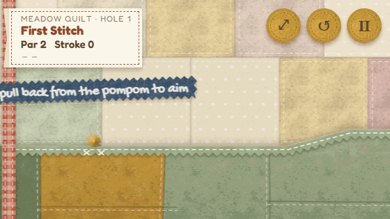

# 🧶 Felt Links

### Side-on crazy golf on a quilt.

Flick a woolly pompom across felt hills, satin slopes and denim runs,<br>
past spinning buttons and a bobbing sewing-machine needle, and sink it in a buttonhole.

<a href="https://gorzawebk.github.io/Felt-Links/"></a>


<a href="https://github.com/GorzaWebK/Felt-Links/actions/workflows/deploy.yml"></a>

[How to play](#-how-to-play) · [Controls](#-controls) · [The three quilts](#-the-three-quilts) · [Run it locally](#-run-it-locally) · [Code layout](#-code-layout)

<sub>✂️ <i>“Felt Links” is a working title.</i></sub>

</div>

---

## 🪡 What it is

Every hole is a little felt diorama on a craft table in warm afternoon light, seen from the side. Pull back from the pompom like a catapult, watch the running stitch show where it's headed, and let go. The cloth wobbles where it lands, the flag is an embroidered pennant, and the scorecard is a cross-stitch sampler that stitches itself in after every hole.

Plays on **PC** (mouse, keyboard or gamepad) and on **phones and tablets** (touch, portrait or landscape). There is no timer, ever.

Everything in the game is made in code: the felt and fabric textures, the quilt, the pompom, the favicon, every sound effect and all the music. The game has no image or audio files (the pictures on this page are screenshots, just for the README).

## 🧵 The three quilts

Three courses of nine holes. Each new obstacle gets a hole of its own, with a chalk note, before it's mixed in with the others.

<table>
  <tr>
    <td width="33%">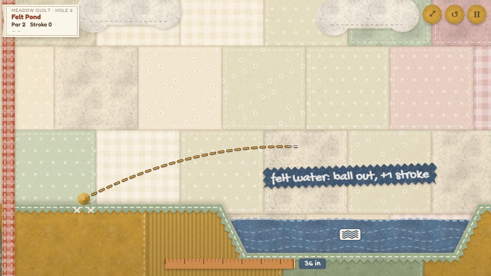</td>
    <td width="33%">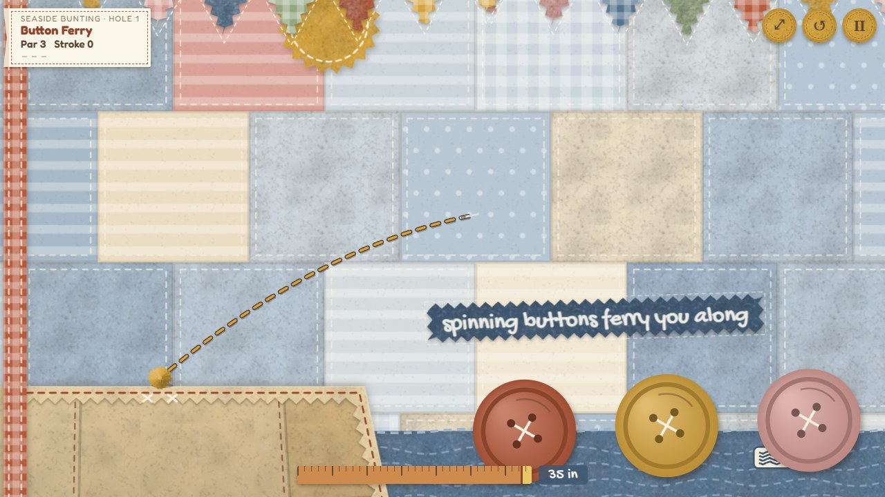</td>
    <td width="33%">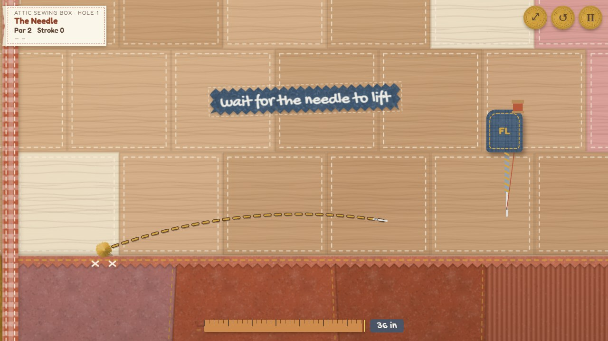</td>
  </tr>
  <tr>
    <td valign="top"><b>🌿 Meadow Quilt</b><br><sub>Rolling sage felt, a felt pond, the first elastic bands, and satin, corduroy and denim to roll on.</sub></td>
    <td valign="top"><b>⛵ Seaside Bunting</b><br><sub>Button ferries, zip piers, ribbon bridges that sag under you, and pincushion rocks. Collect 15 thimbles in the Meadow to open it.</sub></td>
    <td valign="top"><b>🧵 Attic Sewing Box</b><br><sub>The sewing machine's needle, cotton-reel rollers, loose threads that snag, and a hand fan's draught. Collect 15 thimbles at the Seaside to open it.</sub></td>
  </tr>
  <tr>
    <td>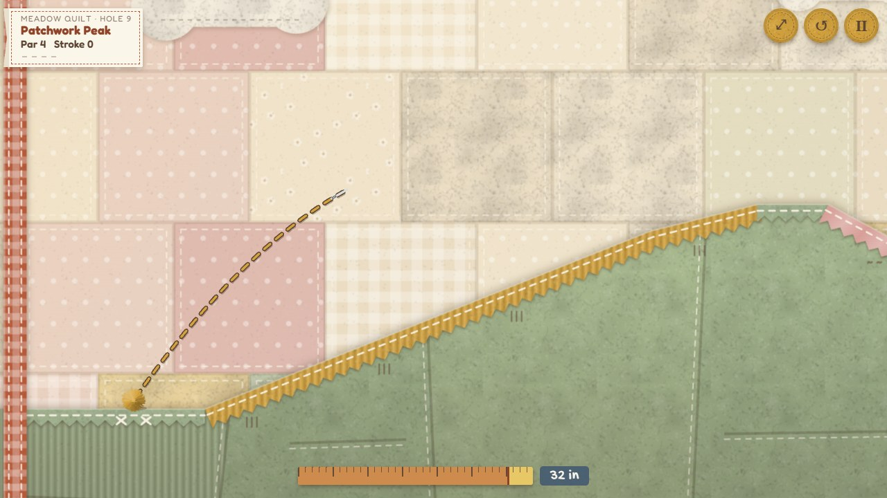</td>
    <td>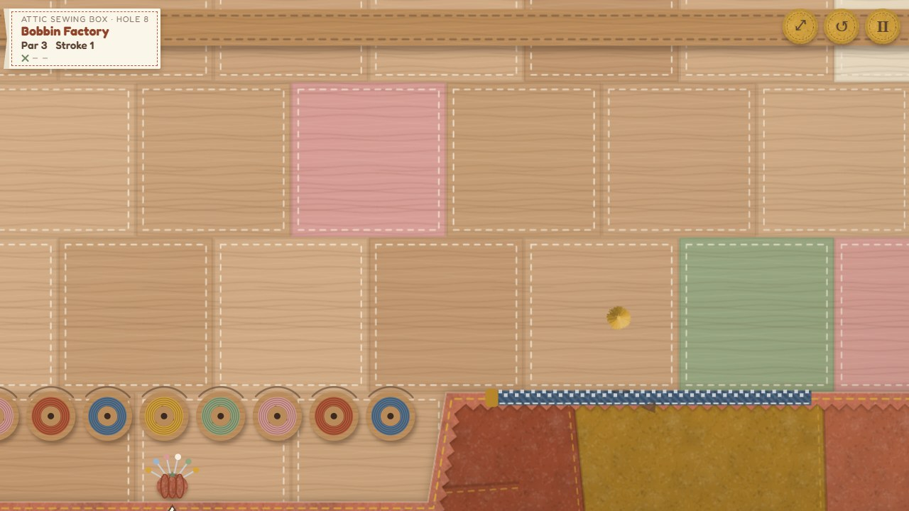</td>
    <td>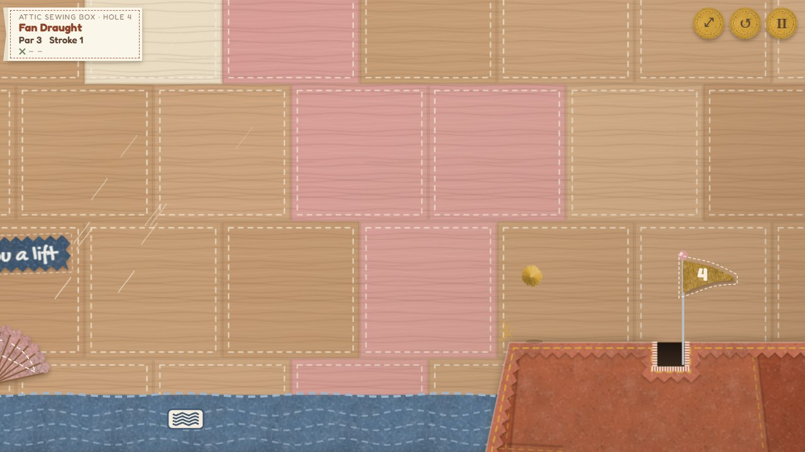</td>
  </tr>
  <tr>
    <td valign="top"><sub><b>Patchwork Peak</b>: corduroy up, satin down, felt water at the bottom.</sub></td>
    <td valign="top"><sub><b>Bobbin Factory</b>: motor-driven reels carry you over the pins.</sub></td>
    <td valign="top"><sub><b>Fan Draught</b>: ride the draught over the water.</sub></td>
  </tr>
</table>

Plus a **daily hole** every day: built from the date, so everyone gets the same one, with your best score kept on the device.

## ⛳ How to play

1. **Aim.** Press anywhere and pull back. The further you pull, the harder the shot; the tape measure at the bottom shows the power. Let go to shoot. You can only shoot once the pompom has stopped.
2. **Sink it** in the buttonhole in as few strokes as you can.
3. **Collect thimbles.** At or under par earns **3 gold thimbles**, one over earns 2, and any finish earns 1. **15 thimbles** in a course opens the next quilt.
4. **No rush.** Press O (or ⤢) to see the whole hole whenever you like. Pick any hole on an open course and the round carries on from there. Stuck? After par + 3 strokes, the pause menu lets you pick up and move on (no thimbles).

### The fabrics

| | Surface | How it plays | Marked with |
| :-: | --- | --- | :-: |
| 🟩 | **Felt** | Grippy: stops quickly and holds a slope | plain, stitched |
| 🩷 | **Satin** | Slippery: barely stops | `~` |
| 🟨 | **Corduroy** | Bumpy: little hops over the ridges | `\|\|\|` |
| 🟦 | **Denim** | Fast: keeps rolling | `///` |

### Notions and hazards

| | Thing | What it does |
| :-: | --- | --- |
| 🪢 | **Elastic bands** | Bumpers: twang you back at least as fast as you came |
| 💧 | **Felt water** | Ball out: +1 stroke, back to where you last stopped. Wave-stitched, with a wave tag |
| 🔘 | **Spinning buttons** | Carry and fling you; a row of them is a ferry. An arrow shows the spin |
| 🤐 | **Zips** | Conveyor belts; the pull tab and arrow show which way they run |
| 🎀 | **Ribbon bridges** | Sag under the pompom and slow it down |
| 📍 | **Pincushions** | Pins snag wool: +1 stroke. Spiky, with a hatched triangle tag |
| 🪡 | **The needle** | Bobs up and down: wait for it to lift. The machine whirrs louder as you get close |
| 🧵 | **Cotton reels** | Rollers that spin as you cross; some are motor-driven |
| 〰️ | **Loose threads** | Snag the pompom and take most of its speed |
| 🪭 | **Hand fans** | Blow you along (and up) while you're in the draught |

## 🎮 Controls

| Action | 🖱️ Mouse / 👆 touch | ⌨️ Keyboard | 🎮 Gamepad |
| --- | --- | --- | --- |
| Aim and set power | Press anywhere, pull back | <kbd>←</kbd> <kbd>→</kbd> aim, <kbd>↑</kbd> <kbd>↓</kbd> power (hold <kbd>Shift</kbd> for fine aim) | Left stick aims; d-pad or LB / RB for fine aim, d-pad ↑ ↓ for power |
| Shoot | Let go | <kbd>Space</kbd> or <kbd>Enter</kbd> | Squeeze the right trigger and let go, or press A |
| Cancel a shot | Pull back to the start, or right-click | <kbd>Esc</kbd> | — |
| See the whole hole | ⤢ button | <kbd>O</kbd> | X |
| Restart the hole | ↺ button | <kbd>R</kbd> | Y |
| Pause | Ⅱ button | <kbd>Esc</kbd> or <kbd>P</kbd> | Start |
| Mute | — | <kbd>M</kbd> | Back / Select |
| Menus | Tap or click | Arrow keys, <kbd>Enter</kbd>, <kbd>Esc</kbd> | D-pad or stick, A, B |

Every keyboard action except <kbd>Esc</kbd> can be rebound in **the button tin** (Settings), and your choice is saved on the device.

## 📌 Menus you could pick up

<table>
  <tr>
    <td width="50%">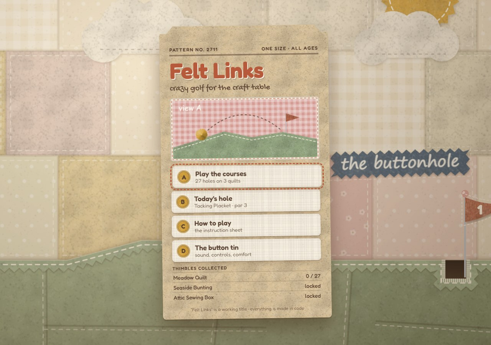</td>
    <td width="50%">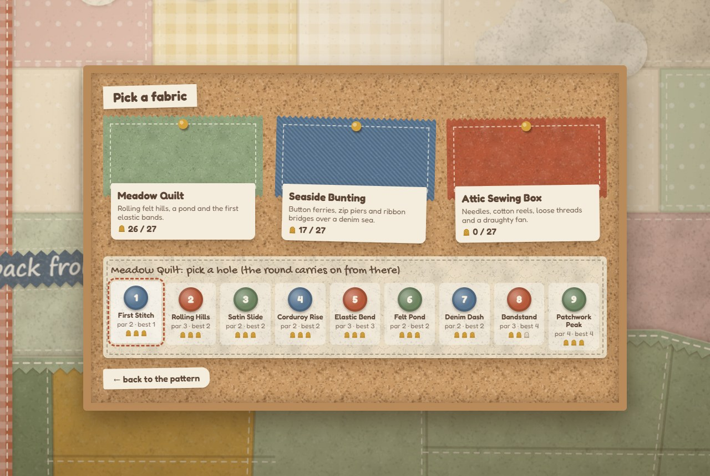</td>
  </tr>
  <tr>
    <td valign="top"><b>The pattern envelope</b><br><sub>The main menu. Views A–D, and a size chart that counts your thimbles.</sub></td>
    <td valign="top"><b>The corkboard</b><br><sub>Course select: three swatches pinned up, then nine sewn-on buttons, one for each hole.</sub></td>
  </tr>
  <tr>
    <td>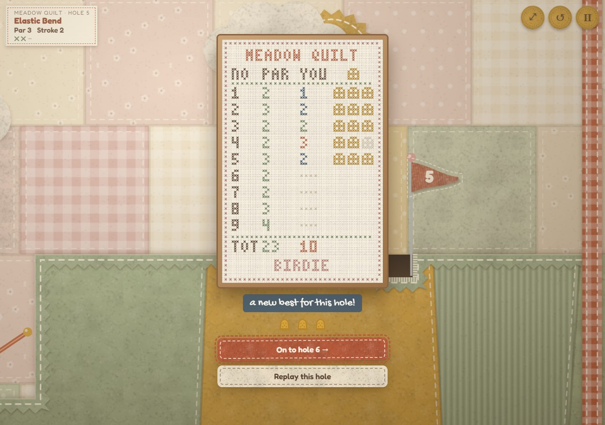</td>
    <td>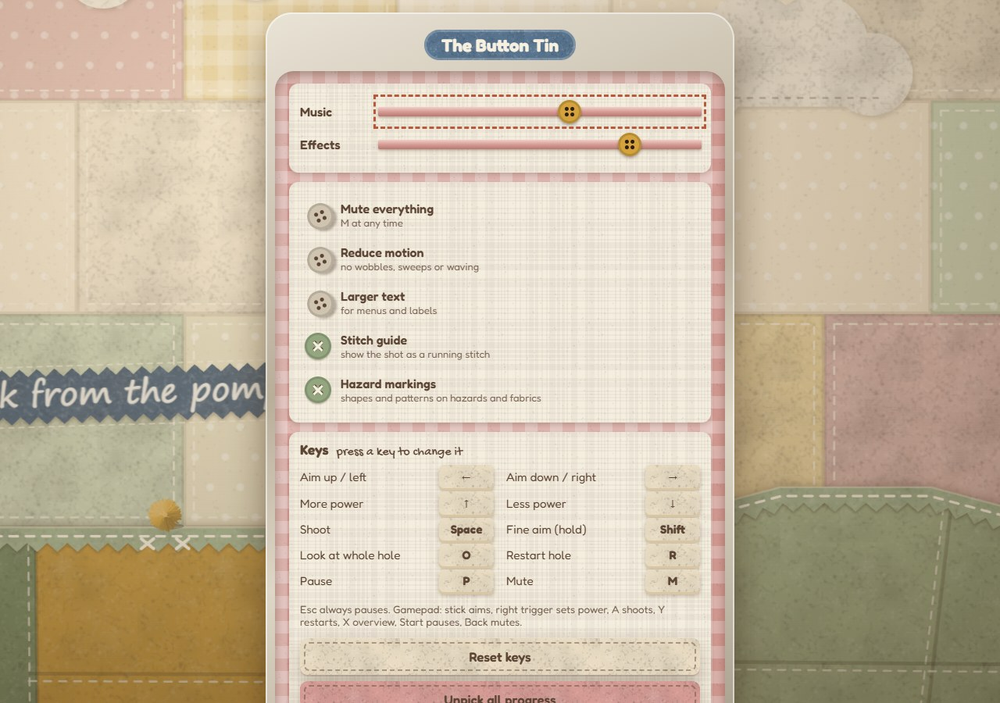</td>
  </tr>
  <tr>
    <td valign="top"><b>The sampler</b><br><sub>The scorecard, stitched in cross by cross after every hole.</sub></td>
    <td valign="top"><b>The button tin</b><br><sub>Settings. Toggles are buttons that are either sewn on or loose, and the sliders are ribbons.</sub></td>
  </tr>
</table>

## 🎨 Look, sound and comfort

<table>
  <tr>
    <td width="240" valign="top">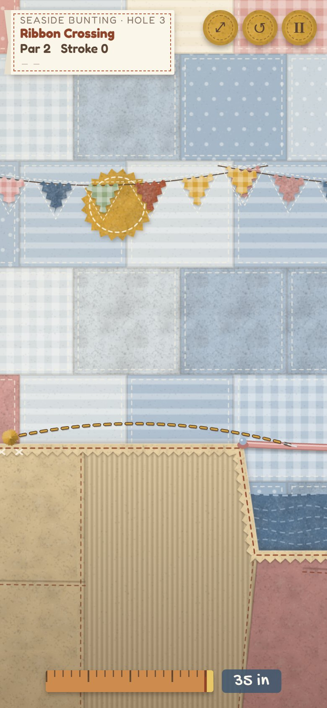</td>
    <td valign="top">

**Textiles everywhere.** Felt made from noise and fibres, corduroy ribs, satin sheen, denim twill, gingham and dot prints, running-stitch outlines, pinked (zig-zag) edges and soft fabric shadows. The palette is warm oatmeal, mustard, rust, sage, dusty rose and denim.

**Little satisfactions.** The cloth wobbles where the pompom lands, a thread unspools as each hole opens, a felt panel stitches across between holes, and the pompom pops into the buttonhole with a music-box flourish.

**Sound and music,** all synthesised with the Web Audio API: woolly thuds that change with the fabric, a woody *plip* for buttons, an elastic *twang*, zip ticks, the sewing machine's whirr, a felt splash. The music is generated live, with one theme per course: plucked strings for the Meadow, ukulele strums at the Seaside, a music-box waltz in the Attic, and a lullaby on the menus.

**Comfort and access.** Hazards are marked by shape and pattern as well as colour. There's an option for reduced motion and one for larger text, music and effects have separate volumes, and every menu works with keyboard, gamepad and touch. **Type:** Fredoka and Gochi Hand (tailor's chalk).

  </td>
  </tr>
</table>

## 🛠️ Run it locally

```bash
npm install
npm run dev           # dev server at http://localhost:5173 (also on your LAN for phone testing)
npm run check:holes   # prove every hole can be completed and its par is fair
npm run build         # static site in dist/
npm run preview       # serve the build at http://localhost:4173/Felt-Links/
```

<details>
<summary><b>🤖 How <code>check:holes</code> keeps the pars fair</b></summary>
<br>

A robot golfer plays every hole, plus the next ten daily holes, using the real game simulation. It searches a grid of shots (angle × power, plus waiting for the needle or fan where a hole has them), keeps the most promising places the pompom stops, and plays on stroke by stroke.

A finish only counts if a person could repeat it: the shot must still go in with the aim 1° off or the power 2.5% off. A par is fair when **robot best ≤ par ≤ robot best + 1**. The daily hole uses the same solver (in a background worker) to settle its own par.

Options: `--only=m1,s3`, `--daily=30`, `--quick`.

</details>

Testing helpers: `window.feltLinks` in the browser console gives you the `game`, the `renderer`, `startRound(course, hole)`, `startDaily()` and `shoot(angle, power)`.

## 🗂️ Code layout

Plain JavaScript ES modules and [Vite](https://vite.dev), drawn with Canvas 2D. No framework, no physics engine, no runtime dependencies.

| File | What it does |
| --- | --- |
| `src/main.js` | Start-up, the game loop and the flow of a round |
| `src/physics.js` | Small physics module: circle against segments and circles, moving surfaces, the surface table, a segment grid |
| `src/sim.js` | One hole as a simulation: ground, cup, obstacles, hazards, settling. No DOM; shared with the checker |
| `src/solver.js` | The robot golfer behind `check:holes` and the daily par |
| `src/holes/meadow.js` · `seaside.js` · `attic.js` | The 27 holes, as data |
| `src/holes/index.js` | Courses, thimbles and unlock rules |
| `src/holes/daily.js` · `src/daily-worker.js` | The daily hole (seeded from the date) and its background par check |
| `src/render.js` | Canvas renderer: camera, the pre-drawn diorama layer, obstacles, pompom, aim stitch, effects, transitions |
| `src/art.js` | Textile art: fabric tiles, stitches, pinking, the pompom, the favicon, CSS textures |
| `src/audio.js` | Synthesised sound effects and generative music |
| `src/ui.js` · `src/sampler.js` | The envelope, corkboard, pause patch, instructions, button tin, HUD, and the cross-stitch scorecard |
| `src/input.js` | Mouse, touch, keyboard (rebindable) and gamepad; menu navigation |
| `src/storage.js` | Progress, best scores, daily results, settings and key bindings in `localStorage` |
| `src/rng.js` | Seeded random numbers and date keys |
| `src/style.css` | The textile menus and HUD, responsive layout |
| `tools/check-holes.mjs` | `npm run check:holes` |
| `docs/media/` | Screenshots for this README (not used by the game) |

## 🚀 Deployment

Every push to `main` checks the holes, builds the game and publishes it to GitHub Pages through `.github/workflows/deploy.yml` (Vite's `base` is `/Felt-Links/`).

<div align="center">
<br>
<sub>🧶 stitched together in code · <a href="https://gorzawebk.github.io/Felt-Links/">play Felt Links</a> 🧶</sub>
</div>
